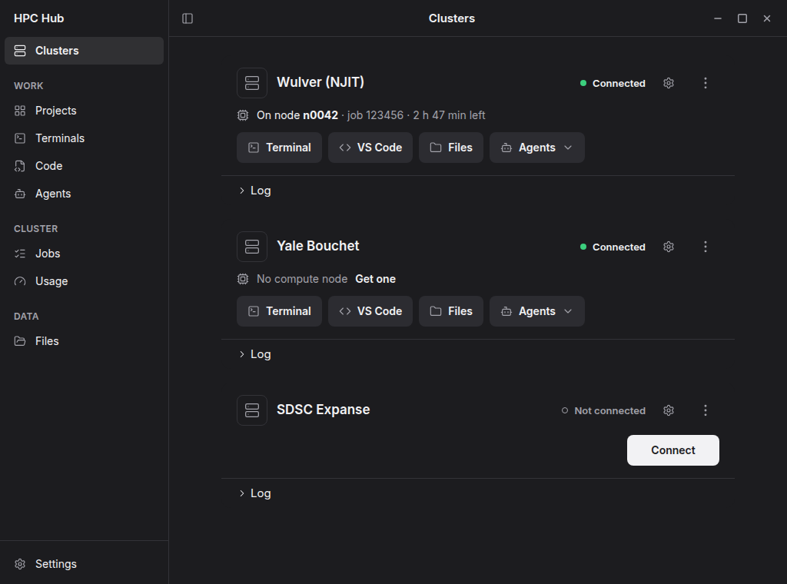
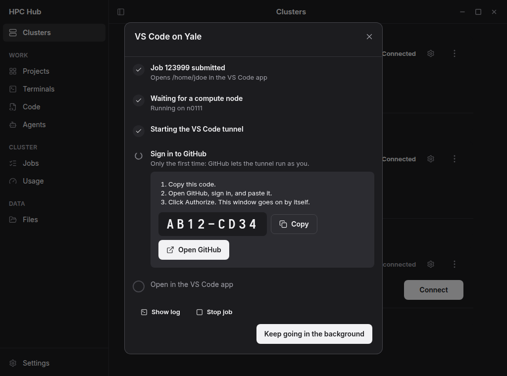
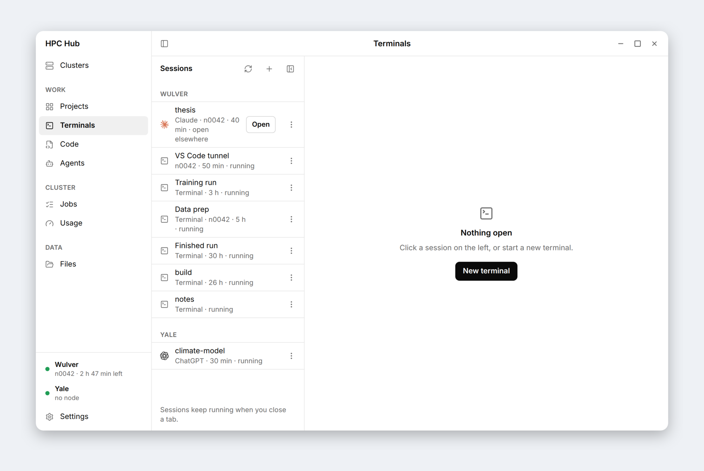
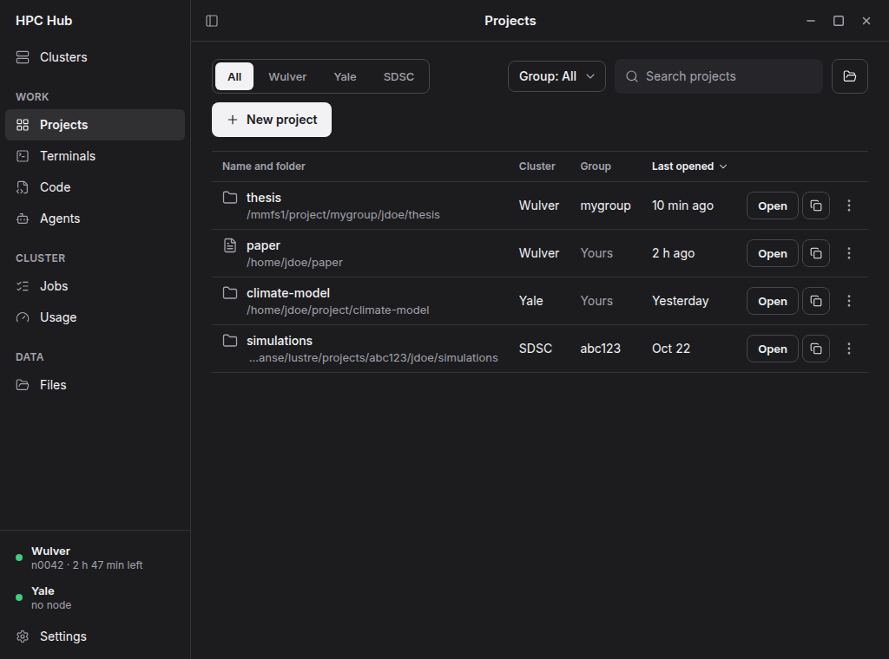
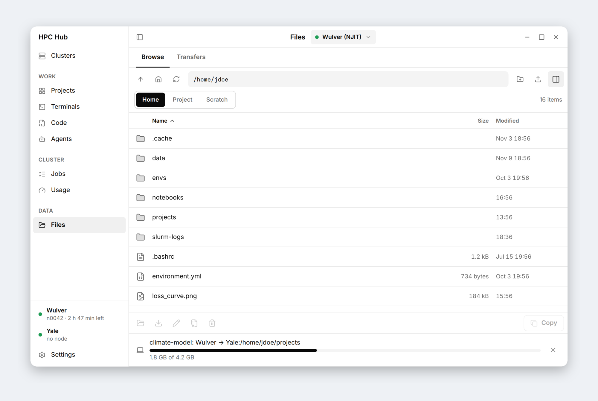
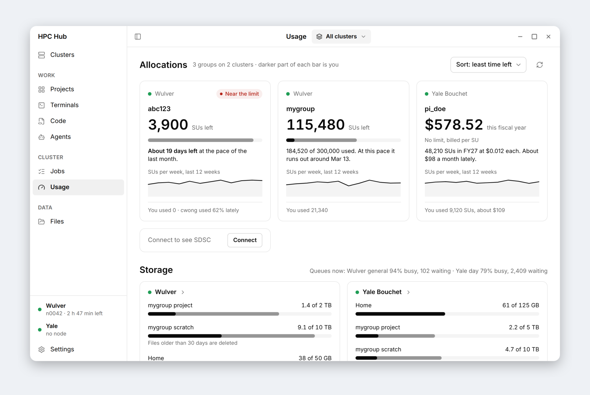

# HPC Hub features

Everything HPC Hub does, so you can focus on your research instead of the cluster. For step by step guides, see the
[docs](https://hpchub.staylazy.app).

**Contents:** [Connect](#connect) · [Compute nodes](#compute-nodes) · [VS Code](#vs-code) ·
[Terminals and AI agents](#terminals-and-ai-agents) · [Projects](#projects) · [Files and transfers](#files-and-transfers) ·
[Jobs and usage](#jobs-and-usage) · [Back up scratch](#back-up-scratch) · [Android](#android) ·
[Install and updates](#install-and-updates) · [Safety and privacy](#safety-and-privacy) · [Experimental](#experimental)

## Connect

One **Connect** button runs your cluster's VPN, sign-in and Duo or authenticator code, and shows each step.

- Sign in with your cluster's username: a UCID, a NetID or an ACCESS username. Typing `ab123@njit.edu` works too.
- The first start checks your password before going on, without sending a Duo push.
- A wrong password opens a window to type it again, and HPC Hub stops after one try so your account isn't locked.
- Several clusters connected at once, each through its own VPN: only that cluster's traffic and names go through
  it, and the rest of your internet stays as it is.

<p align="center"></p>

## Compute nodes

Ask for a node by size instead of writing Slurm commands. HPC Hub only sends a request Slurm can start.

- Pick **Light CPU** (2 cores, 8 GB), **Heavy CPU** (8 cores, 32 GB) or **GPU**, then adjust cores, memory and time up
  to what the queue allows.
- Queues and priorities are read from Slurm. Queues for other groups are hidden, and CPU sizes don't list GPU-only
  queues.
- A queue that takes only its own priority switches to it, and a GPU-only queue adds a GPU, saying why.
- See the cost in service units before you ask, a warning when your time runs into maintenance, and a notification
  about 15 minutes before your node's time ends.

## VS Code

VS Code runs on a compute node as a job of its own and opens in the VS Code app or your browser.

- The window shows every step: in the queue (and why), starting, the GitHub code to type the first time, installing
  VS Code on the node, and running.
- One VS Code job per cluster: open it again, see its log or stop it, instead of starting a second one by accident.
- A job that can never start says so, and **Stop and change** takes you back to pick another queue.
- Close the window anytime: VS Code still opens when it's ready.

<p align="center"></p>

## Terminals and AI agents

Terminals and agents run in tmux on the cluster, so they keep going after you close the laptop, until the node's time
ends.

- Open a terminal on the login node or your compute node, and reconnect to any tmux session, including your own.
- A timeline of the whole session: jump between your prompts, and mark places to come back to.
- Run Claude, ChatGPT (Codex), Antigravity or Cursor on a compute node, continue an earlier chat, or ask several
  agents the same question.
- Paste a screenshot into a terminal: HPC Hub puts it on the cluster, so Claude or Codex can see it.
- Decide what Claude may do on each cluster: edit without asking, keep deleted files for 7 days, always ask before
  cancelling jobs or force pushing.

<p align="center"></p>

## Projects

A project is a saved name for a folder on a cluster, one click from every tool.

- Open a project in VS Code, an agent, Files, a terminal or the code editor.
- Start new projects empty, as Python or as a LaTeX paper, optionally as a git repository.
- Copy or sync a project to another cluster, with Globus for large ones, and take your Claude chats along.
- Every folder picker lists your projects.

<p align="center"></p>

## Files and transfers

Browse, preview and edit files on each cluster, and copy them anywhere.

- Preview PDFs, images and text next to the list; the PDF viewer can search, zoom and read aloud.
- Upload, download, rename, zip and unzip, and edit files in place.
- Copy between clusters through your computer, or with Globus, which keeps going after you close the app.
- Every transfer shows its progress in one place.

<p align="center"></p>

## Jobs and usage

See what your jobs are doing and what your group has left.

- Your jobs, your group's, your history or everyone's, with search and filters.
- Why a job waits, in plain words, its output files, and cancel jobs. A notification tells you when a job ends.
- Service units left per group, how long they last at your recent pace, and storage quotas.
- How busy each queue is now, and the limits of each queue and priority.

<p align="center"></p>

## Back up scratch

Clusters delete old scratch files. HPC Hub shows what's at risk and copies what you choose to your project space.

- See your cluster's purge rule, and which files go soon and how big they are.
- Choose what to keep, try it first, then copy. The copy runs on the cluster, so you can close the app.
- Nothing in scratch is changed or deleted, and copies are checked at the end.
- A weekly check tells you what's at risk.

## Android

The same pages on your phone (preview, not in a store yet).

- Sign in by scanning a QR code from the desktop app; Duo asks on the phone.
- The phone and the computer see the same sessions, marks and jobs.
- Notifications for Duo, a node's time, a finished job or copy, and files close to deletion.

## Install and updates

One command installs HPC Hub; nothing is installed on the cluster.

**Windows** (PowerShell)

```powershell
irm https://github.com/bavanDA/hpc-hub/releases/latest/download/install.ps1 | iex
```

**macOS and Linux** (Terminal)

```sh
curl -fsSL https://github.com/bavanDA/hpc-hub/releases/latest/download/install.sh | sh
```

- The command checks the download against the release's checksums. Running it again updates HPC Hub.
- From version 0.2.1, new versions install from the app with one click: **Update** in the sidebar, or **Check for
  updates** in Settings. Your work on the clusters keeps running while it restarts.

## Safety and privacy

- Passwords stay in your system's keyring (Keychain, Credential Manager, GNOME Keyring), never in plain text.
- No HPC Hub account and no tracking. HPC Hub connects only to your clusters, the services you choose (like Globus or
  an AI agent) and GitHub to check for updates.
- In-app updates are checked for a valid signature before they install.
- A problem report is sent only when you choose to, and you see everything in it first.

## Experimental

Off until you turn them on in Settings, under Experimental. They may change.

- **Papers:** a LaTeX editor for a project on the cluster, built with latexmk, with git history.
- **Skills:** add instructions to your agents on each cluster.
- **Scheduled agents:** an agent runs a task at set times, for example every night, as a Slurm job.

---

Built in: SDSC Expanse, NJIT Wulver and Yale Bouchet. Adding yours takes [one file](CONTRIBUTING.md).
Back to the [README](README.md).
