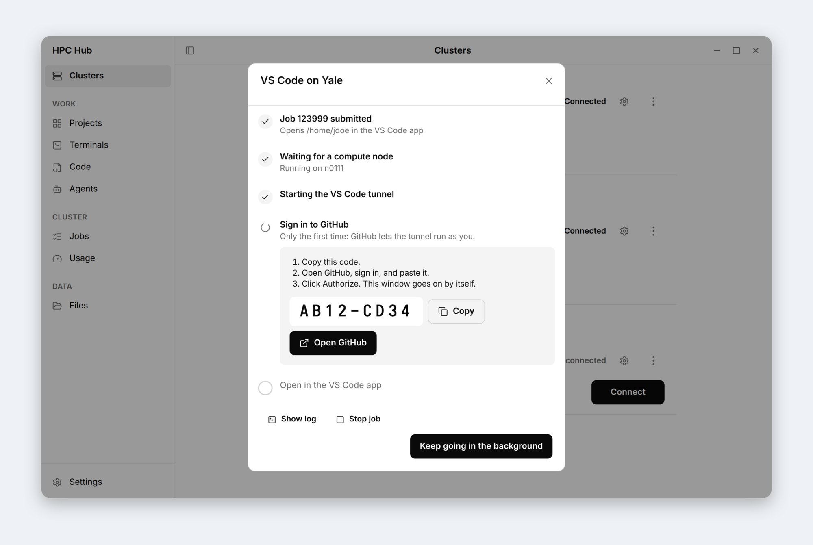

<p align="center">
  
</p>

<h1 align="center">HPC Hub</h1>

<p align="center">VPN, SSH, and Duo from one Connect button. Then a compute node.</p>

<p align="center">
  <a href="https://github.com/bavanDA/hpc-hub/releases/latest"></a>
  <a href="https://hpchub.staylazy.app/install.html"></a>
  <a href="LICENSE"></a>
</p>

<p align="center">
  <a href="https://hpchub.staylazy.app">Docs</a>
  ·
  <a href="https://github.com/bavanDA/hpc-hub/releases">Download</a>
</p>

<p align="center">
  
</p>

## Why HPC Hub

To work on a university HPC cluster you juggle a VPN client, SSH, Duo or an authenticator code, Slurm commands to get a compute node, a VS Code tunnel, and tmux so the work survives closing the laptop.

| Before | After |
| --- | --- |
| VPN, SSH, Duo, Slurm, a tunnel, and tmux | Connect, then pick a node size |
| Write Slurm to get a machine | Light CPU, Heavy CPU, or GPU |
| tmux, so closing the laptop is safe | The session keeps running until the job's time runs out |

## Features

<table>
  <tr>
    <td width="50%" valign="top"><b>Connect.</b> One button handles the VPN, SSH, and Duo (or the authenticator code), depending on the cluster.<br><br><b>A node by size.</b> Pick Light CPU, Heavy CPU, or GPU, and set the queue and priority, instead of writing Slurm commands.<br><br><b>On the node.</b> Open VS Code, Claude, Codex, or a terminal. VS Code shows each step until it is ready, including the GitHub code. The session keeps running after you close the laptop, until the job's time runs out.</td>
    <td width="50%" valign="top"></td>
  </tr>
  <tr>
    <td width="50%" valign="top"></td>
    <td width="50%" valign="top"><b>Projects.</b> One click opens a folder in VS Code, Claude, or Files. Copy a project to another cluster.<br><br><b>Files.</b> Browse, preview PDFs and images, edit, upload, download, copy between clusters, and Globus transfers.</td>
  </tr>
  <tr>
    <td width="50%" valign="top"><b>Jobs and usage.</b> Your jobs, history, service units, and storage.<br><br><b>Updates.</b> One-click updates in the app, from version 0.2.1.</td>
    <td width="50%" valign="top"></td>
  </tr>
</table>

## Install

Free and open source, for Windows, macOS (Apple silicon), and Linux.

**Windows** (PowerShell)

```powershell
irm https://github.com/bavanDA/hpc-hub/releases/latest/download/install.ps1 | iex
```

**macOS and Linux** (Terminal)

```sh
curl -fsSL https://github.com/bavanDA/hpc-hub/releases/latest/download/install.sh | sh
```

Or download from [Releases](https://github.com/bavanDA/hpc-hub/releases). Guide: [hpchub.staylazy.app/install.html](https://hpchub.staylazy.app/install.html).

## Supported clusters

Built in: SDSC Expanse, NJIT Wulver, and Yale Bouchet. Adding yours is [one file](CONTRIBUTING.md).

## Contributing

Contributions welcome. See [CONTRIBUTING.md](CONTRIBUTING.md).

## Safety

Passwords stay in the system keyring. In-app updates are signature-checked. Installers are not code-signed yet.

## License

MIT. See [LICENSE](LICENSE).
