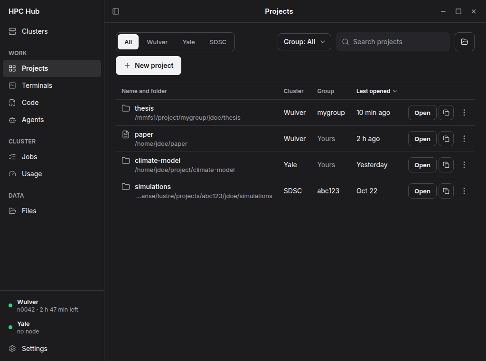
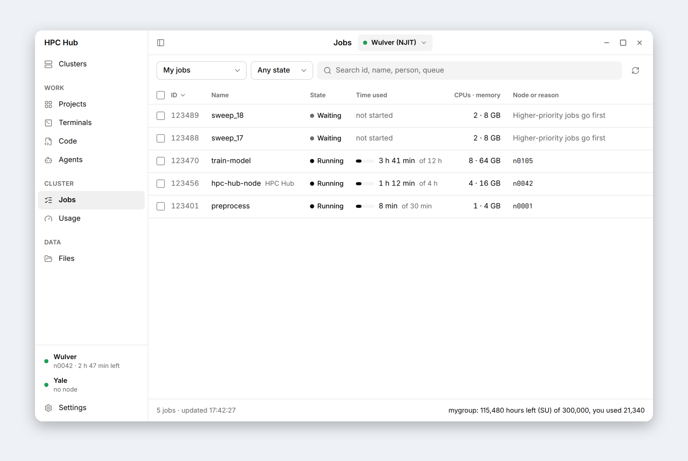

# HPC Hub

A desktop app for working on HPC clusters from Linux. One click connects you (VPN, SSH, Duo or a code from your
authenticator app), gets you a compute node, and opens VS Code, Claude or a terminal there. Files, jobs, Globus
transfers and LaTeX are in the same window.

It comes set up for NJIT Wulver, Yale Bouchet and SDSC Expanse. You can add other clusters in Settings.

| Projects | Jobs |
|---|---|
|  |  |

## What it does

- **Clusters**: connect with one button. VPN, SSH and Duo push are handled for you. Ask for a compute node with the
  cores, memory and time you saved for that cluster.
- **Jobs and usage**: your jobs, your history or everyone's, with filters, details and cancel. Service units per
  person and storage quotas.
- **Projects**: name a folder on a cluster and open it in VS Code, Claude, Files or LaTeX in one click. Copy or sync a
  project, with its Claude chats, to another cluster.
- **Terminals**: tmux sessions on the cluster, so VS Code tunnels and agents keep running when you close the laptop.
- **Agents**: run Claude, Codex, Antigravity or Cursor on a compute node, and choose which commands they may run.
- **Files**: browse, preview PDFs and images, edit, zip, upload and download. Copy between clusters directly or with
  Globus, with live progress.
- **Globus**: sign in once. The app finds each cluster's collection by itself and asks only for the permissions
  Globus needs.

Experimental, off until you turn them on in Preferences:

- **LaTeX**: an Overleaf-like editor for projects on the cluster. Build with latexmk, jump between source and PDF,
  see git history, pull and push.
- **Skills**: add skills to Claude and Codex on each cluster, from HPC Hub's set or any git repository.
- **Scheduled agents**: an agent runs a task on its own, for example every night at 02:00.

## Safety

- Usernames and passwords are typed into the app and kept in GNOME Keyring on your computer, never in plain text
  and never hardcoded. Settings in `~/.config/hpc-hub` hold no secrets.
- Globus sign-in uses OAuth with PKCE in your own browser. Tokens are kept in the keyring.
- Your saved VPN password is typed only into sign-in pages of your university's own site or a known sign-in
  provider, over https.
- One exception, on the cluster: VS Code keeps its GitHub sign-in in your home folder there, unencrypted, so a
  tunnel on a new node does not ask you again. Sign out with `code tunnel user logout` if you don't want that.

## Install

Fedora:

    sudo dnf install python3-gobject python3-cairo python3-cryptography gtk4 libadwaita libsecret \
        webkitgtk6.0 vte291-gtk4 gtksourceview5 poppler-glib openconnect NetworkManager-openconnect openssh-clients
    ./install.sh

This adds HPC Hub to the app grid and `hpc-hub` to `~/.local/bin`. To run it without installing: `./bin/hpc-hub`.

## Globus

Globus copies need a free Globus app id. Make one at app.globus.org/settings/developers (choose a native app, name it
HPC Hub, redirect URL `https://auth.globus.org/v2/web/auth-code`) and paste it on the Globus page.

## Code layout

    bin/          launcher, plus the helpers ssh and openconnect call (askpass, SSO)
    hpc_hub/
      core/       config, keyring, SSH: used by every feature
      connect/    VPN, sign-in, Duo, cluster cards
      compute/    Slurm, compute nodes, jobs, usage
      files/      browse, edit and copy files on the clusters
      globus/     Globus sign-in, collections and transfers
      agents/     Claude and other agents, chats, skills, permissions
      latex/      LaTeX editor, build, SyncTeX, git
      pdf/        PDF viewers and read aloud
      projects/   named project folders and copying them across clusters
      terminals/  tmux sessions and terminal tabs
      ui/         main window and shared widgets
    tests/        same folders as hpc_hub/

## Development

    python3 -m venv --system-site-packages .venv
    .venv/bin/pip install pytest ruff
    .venv/bin/python -m pytest -q
    .venv/bin/ruff check hpc_hub tests

Guidelines:

- Each feature keeps its logic at the top of its folder and its GTK pages and dialogs in `ui/`. Logic that parses
  output or builds shell commands stays out of `ui/` and has tests. Shared test fakes are in `tests/helpers.py`.
- Keep modules small and about one thing. A UI file over about 400 lines should be split.
- Never block the GTK main loop: run remote work with `widgets.bg(work, done)`.
- Remote commands go through `SshMaster.run`. Quote paths with `shlex.quote`.
- Never hardcode usernames, passwords or personal paths, including in tests. Use made-up names like `jdoe`.
- Short docstrings, few comments, and only ones that say why. Lines up to 120 characters.
- UI text: plain and short, no em or en dashes.
- Commits: atomic, `type(scope): short msg`.
