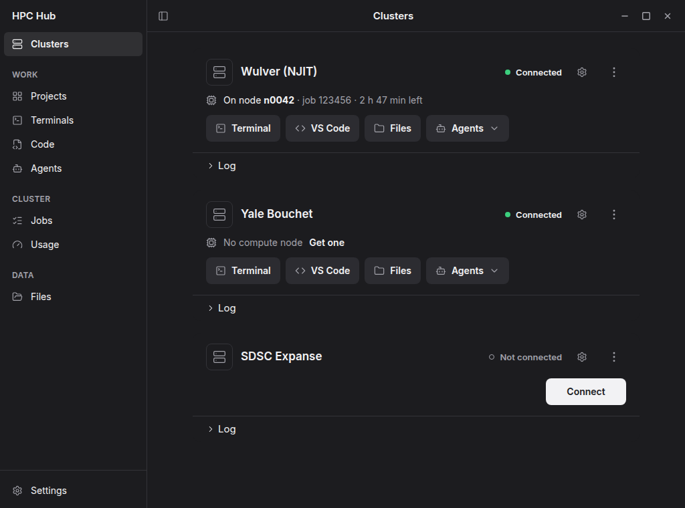

# HPC Hub

A desktop app for HPC clusters on Windows, macOS and Linux.
Connect to a cluster, get a compute node and run VS Code, Claude or a terminal on it.

**Docs:** [hpchub.staylazy.app](https://hpchub.staylazy.app)

## Supported clusters

Built in: **SDSC Expanse**, **NJIT Wulver** and **Yale Bouchet**.
Want your cluster built in? Contributions are welcome.

## Features

- VPN and SSH connections with Duo, SSH keys or authenticator codes, depending on the cluster.
- VS Code, Claude, Codex and terminals on compute nodes.
- Sessions keep running when you close the app, until you stop them or the node's time runs out.
- Projects, files, jobs, usage and Globus transfers in one window.

## Install

- **Windows:** run `irm https://github.com/bavanDA/hpc-hub/releases/latest/download/install.ps1 | iex` in PowerShell.
- **macOS and Linux:** download from [Releases](https://github.com/bavanDA/hpc-hub/releases).

From version 0.2.1, new versions install from the app with one click. See the
[install guide](https://hpchub.staylazy.app/install.html) for details.

## Contributing

Cluster support, fixes and documentation are welcome. See [CONTRIBUTING.md](CONTRIBUTING.md).

## Safety

Saved passwords are stored in your system's keyring. In-app updates are checked for a valid signature before they
install.

## License

[MIT](LICENSE)
